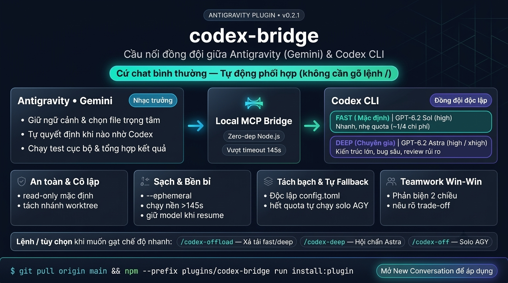

# Codex Bridge (`codex-bridge`)

Zero-dependency Local Stdio MCP Server (Node.js >= 20, pure ESM) pairing **Antigravity Orchestrator** with your local **Codex CLI** (`codex exec` / `codex exec resume` / `codex exec review`) in a two-tier peer workflow.



> Interactive HTML version (offline, mode explorer + 1-click 1920×1080 PNG export): [`docs/codex-bridge-infographic.html`](docs/codex-bridge-infographic.html)

## Features

- **Two-tier model profiles decoupled from `~/.codex/config.toml`**:
  - `profile: "fast"` *(default)* → `gpt-6.2-sol` (`reasoning_effort: "high"`) for fast second opinions, routine reviews, independent edits/tests, and low-quota offload.
  - `profile: "deep"` → `gpt-6.2-astra` (`reasoning_effort: "high"`, overrideable to `xhigh`/`ultra`) for major architecture, stubborn bugs, and high-risk reviews.
  - Changing your interactive model in Codex App / `~/.codex/config.toml` never silently alters `codex-bridge` calls, and every tool response includes the resolved `profile`, `model`, and `reasoning_effort`.
- **Bundled slash skills (`/` commands in Antigravity chat)**:
  - `/codex-offload` — conserve Gemini quota by delegating most implementation, refactoring, tests, and reviews to Codex CLI with flexible tier/model routing (`fast` for routine work, `deep` upfront for complex/high-risk tasks, or an explicit tier/model like `/codex-offload deep ...`).
  - `/codex-deep` — start a read-only peer architectural debate or hard-bug diagnosis with GPT-6.2 Astra before editing files, surfacing both perspectives for you to decide.
  - `/codex-off` — disable all `codex_*` tool calls for the current conversation so Antigravity works 100% solo without consuming Codex quota.
- **Automatic Codex quota fallback**: If Codex CLI fails with a quota or rate-limit error (`quota_limited: true`), `codex-bridge` flags it so Orchestrator stops calling Codex and finishes the session solo in Antigravity.
- **Win-Win peer handoff**: Prompts invite Codex to act as a senior peer engineer — flagging flawed assumptions, edge cases, or cleaner alternatives instead of following one-way commands blindly.
- **Session model preservation**: Runs `--ephemeral` by default; when `persist_session: true` is used, resuming via `session_id` without specifying `profile`/`model` preserves that tracked session's saved profile/model (and omits `-m` on untracked personal sessions).
- **Safe isolation modes & Windows process handling**: Defaults to `read-only`; supports `worktree` (`--worktree`) and `workspace-write` (per-`cwd` lock). Passes prompts over `stdin` (`-`), caps output at `<= 8.5 KB`, transitions runs exceeding `145s` to background `job_id`, and kills process trees with `taskkill /T /F`.

## Prerequisites

- **Node.js** `>= 20.0.0`
- **Codex CLI** (`codex.exe` on Windows / `codex` on POSIX) installed and signed in (`codex login`)
- **Windows sandbox setting**: In `~/.codex/config.toml`, configure:
  ```toml
  [windows]
  sandbox = "unelevated"
  ```
  Verify with `codex doctor`. Without this setting on Windows, `read-only` shell commands inside Codex CLI can fail with `rejected: blocked by policy`.

## Quick Start on a New Machine

```powershell
git clone https://github.com/thanhtd-uk/agy-plugins.git
cd agy-plugins
npm --prefix plugins/codex-bridge run install:plugin
npm --prefix plugins/codex-bridge run doctor
```

Then reload or start a new Antigravity conversation so the plugin's MCP server, rules, and slash skills (`/codex-offload`, `/codex-deep`, `/codex-off`) are loaded.

## Installation & Diagnostics Commands

Run from `plugins/codex-bridge/`:

```powershell
# Install runtime files (including bundled slash skills) to ~/.gemini/config/plugins/codex-bridge and run strict validation
node scripts/install.mjs install

# Check Node, Codex CLI, auth, rules size, bundled skills, profile mapping, and strict validation
node scripts/install.mjs doctor

# Remove installed plugin from ~/.gemini/config/plugins/codex-bridge
node scripts/install.mjs uninstall
```

## MCP Tools (`eager: true`)

| Tool | Purpose | Key Parameters |
| :--- | :--- | :--- |
| `codex_exec` | Run `codex exec` or `codex exec resume` | `cwd` (required abs path), `prompt`, `mode` (`read-only`\|`worktree`\|`workspace-write`), `profile` (`fast`\|`deep`), `model`, `reasoning_effort`, `focus_files`, `context`, `constraints`, `persist_session`, `session_id`, `wait_sec`, `max_runtime_sec`, `max_output_chars` |
| `codex_review` | Run ephemeral `read-only` review | `cwd` (required Git repo), `uncommitted` / `base` / `commit`, `title`, `prompt`, `profile` (`fast`\|`deep`), `model`, `reasoning_effort`, `wait_sec` |
| `codex_job` | Manage background jobs (>145s) | `action` (`wait`\|`status`\|`cancel`\|`list`), `job_id`, `wait_sec` |
| `codex_session` | Manage bridge-tracked sessions | `action` (`list`\|`archive`\|`delete`), `session_id`, `allow_untracked` |

## Environment Variables

| Variable | Default | Description |
| :--- | :--- | :--- |
| `CODEX_BRIDGE_DEFAULT_PROFILE` | `fast` | Default tier when `profile` and `model` are omitted (`fast` or `deep`). |
| `CODEX_BRIDGE_FAST_MODEL` | `gpt-6.2-sol` | Model slug mapped to `profile: "fast"`. |
| `CODEX_BRIDGE_FAST_EFFORT` | `high` | Default `reasoning_effort` for `profile: "fast"`. |
| `CODEX_BRIDGE_DEEP_MODEL` | `gpt-6.2-astra` | Model slug mapped to `profile: "deep"`. |
| `CODEX_BRIDGE_DEEP_EFFORT` | `high` | Default `reasoning_effort` for `profile: "deep"`. |
| `CODEX_BRIDGE_MODEL` | Unset | Optional legacy raw model slug override when `profile` and `model` are omitted. |
| `CODEX_BRIDGE_BIN` | Auto-detected | Explicit path to `codex.exe` (falls back to `%LOCALAPPDATA%\Programs\OpenAI\Codex\bin\codex.exe`, then `PATH`). |
| `CODEX_BRIDGE_GIT_BIN` | Auto-detected | Optional fully qualified path to `git.exe` / `git`. |
| `CODEX_BRIDGE_MAX_JOBS` | `3` | Maximum concurrent Codex jobs (`1..10`). |
| `CODEX_BRIDGE_SESSION_STORE` | `%LOCALAPPDATA%\codex-bridge\sessions.json` | Path to the bridge-owned session ledger. |

## Troubleshooting

- **`rejected: blocked by policy` on Windows**: Add `[windows]` + `sandbox = "unelevated"` to `~/.codex/config.toml` and verify with `codex doctor`.
- **`mode="worktree"` fails on a new repo**: Git requires at least one commit (`HEAD`) before creating worktrees. Make an initial commit or use `mode="workspace-write"`.
- **`Codex CLI executable not found`**: Run `node scripts/install.mjs doctor` or set `CODEX_BRIDGE_BIN` in `mcp_config.json`.
- **Tests**: `npm --prefix plugins/codex-bridge test`
